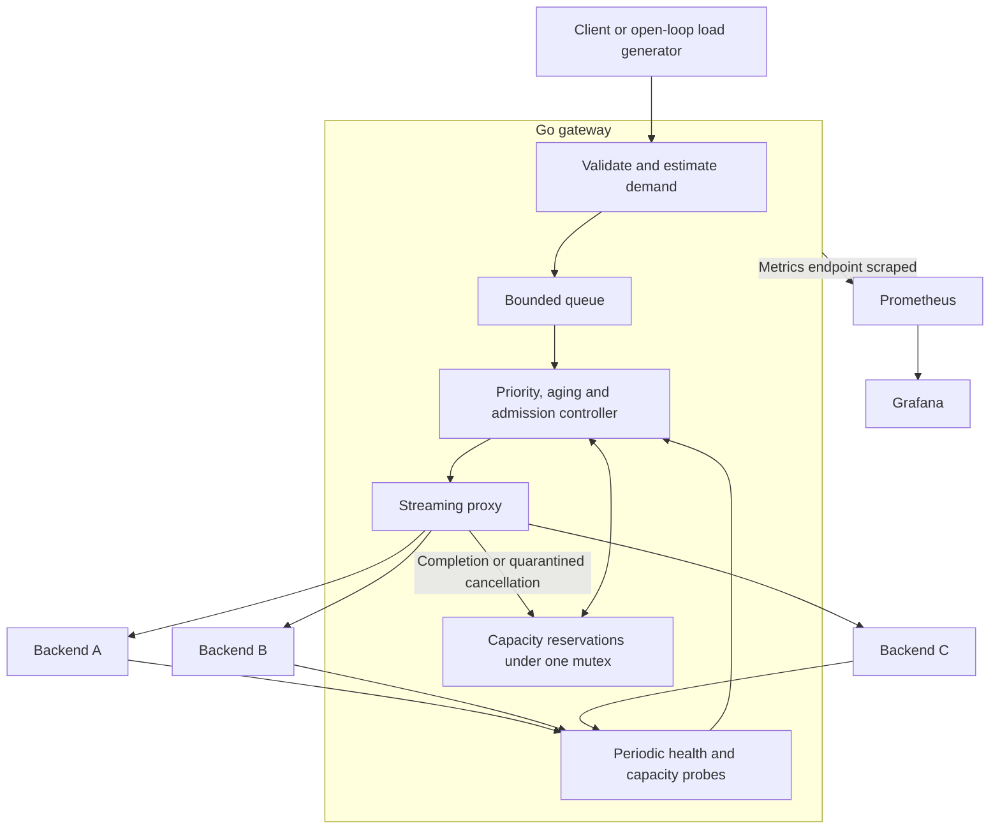

# Memory-Aware Inference Gateway

A Go inference gateway that estimates request demand, reserves backend capacity atomically, and routes or queues work under load. Includes a real Ollama adapter, a controlled three-backend simulator, reproducible policy comparisons, and Prometheus/Grafana monitoring.

**Memory awareness in this version means a conservative logical token budget. It is not measured GPU memory or a guarantee against backend OOM.** All supplied performance experiments use simulation. There are no runtime Go dependencies.

## Run locally

Requires Go 1.24 or later. This workspace also has a downloaded official compiler under `.tools/go`, which `make` detects automatically. Docker is optional.

```sh
make build
make test
make demo
```

`make demo` starts the gateway on `127.0.0.1:8080` and three simulators on ports 9001–9003. It runs until Ctrl-C; logs go into `results/demo/`. Keep it running and use a second terminal:

```sh
curl -N http://127.0.0.1:8080/v1/generate \
  -H 'Content-Type: application/json' \
  -d '{"prompt":"Explain inference admission control","max_tokens":32,"priority":0}'

curl http://127.0.0.1:8080/readyz
curl http://127.0.0.1:8080/metrics
```

Or run the full monitoring environment:

```sh
docker compose up --build
```

- Gateway: <http://127.0.0.1:8080/readyz>
- Prometheus: <http://127.0.0.1:9090>
- Grafana: <http://127.0.0.1:3000/d/memory-gateway> (dashboard provisioned automatically)

The Compose setup binds host ports to loopback. Grafana permits anonymous viewing; the development admin credentials are `admin` / `local-demo-only`, overridable with `GRAFANA_ADMIN_PASSWORD`. These are local development defaults.

## Run on Kubernetes

The root `kustomization.yaml` deploys the gateway, three simulator backends, Prometheus, and Grafana into the `memory-gateway` namespace. It reuses the existing gateway configuration, alert rules, and dashboard. Requires Docker, kubectl, and a cluster; for a local kind cluster:

```sh
kind create cluster --name memory-gateway
docker build -t memory-inference-gateway:local .
kind load docker-image memory-inference-gateway:local --name memory-gateway
make k8s-apply
make k8s-smoke
kubectl -n memory-gateway port-forward --address=127.0.0.1 service/gateway 8080:8080
```

The gateway is then available at `http://127.0.0.1:8080`. `make k8s-smoke` waits for all deployments and checks backend connectivity, generation, Prometheus scraping and alerts, and the Grafana dashboard and data source. It closes its temporary port forwards when finished.

See [the Kubernetes guide](docs/kubernetes.md) for monitoring access, registry images, updates, troubleshooting, and cleanup. **Keep one gateway replica and one replica per backend.** Capacity reservations are local to each gateway, and each configured backend URL must identify one inference process. The manifests use `Recreate` updates, which briefly interrupt service.

## Use Ollama on your Mac

With Ollama installed and running, pull the example model and start the gateway:

```sh
ollama pull llama3.2:1b
./bin/gateway -config configs/ollama.json
```

Use the same `/v1/generate` request as above. The gateway supplies the configured model when `model` is omitted. Change `configs/ollama.json` to use another installed model. Stop the simulator demo first because both configurations listen on port 8080.

The adapter calls Ollama's [`/api/generate`](https://docs.ollama.com/api/generate) with streaming enabled, forwards `max_tokens` as `options.num_predict`, and aggregates the response if the client requests `stream:false`. It checks `/api/tags` for the configured model. Its capacity comes from configuration; Ollama does not supply live memory telemetry to this implementation. The example deliberately allows only one concurrent generation.

## API

`POST /v1/generate` accepts:

```json
{
  "model": "demo",
  "prompt": "Your prompt",
  "max_tokens": 128,
  "priority": 0,
  "stream": true
}
```

Only `prompt` is required. `priority` is 0 (normal), 1 (elevated), or 2 (urgent). `stream` defaults to true. This is a small project API, not an OpenAI-compatible chat endpoint. Unknown fields, unsupported models, negative output limits and malformed JSON are rejected. See `internal/config/config.go` for all defaults and `configs/` for runnable examples.

Streaming uses newline-delimited JSON:

```json
{"model":"demo","response":"t0 ","done":false}
{"model":"demo","done":true,"prompt_eval_count":10,"eval_count":1}
```

A successful HTTP status alone does **not** establish success: the client must receive `done:true` without an error. An interrupted stream ends with an error record when the connection still permits writing. The gateway never retries generation requests automatically, including requests that fail before their first token.

| Status | Meaning |
| --- | --- |
| 400 | Invalid request, model or output limit |
| 408 | Request canceled before dispatch |
| 413 | Body, context estimate or demand exceeds a configured limit |
| 429 | Queue is full; `Retry-After: 1` |
| 502 | Backend rejected the request or failed before a response was committed |
| 503 | Queue deadline expired or gateway is shutting down; `Retry-After: 1` |
| 504 | Total request deadline exceeded before a response was committed |

`GET /healthz` checks process liveness. `GET /readyz` returns backend state and 200 when at least one backend has fresh healthy telemetry with a closed circuit. Readiness does not promise immediate capacity. `GET /metrics` exposes Prometheus text metrics. Response headers identify the selected backend, estimated reservation and queue wait.

## Scheduling and reliability



The estimate is `ceil((ceil(prompt_bytes / 3) + 16 + max_tokens) * estimate_multiplier)`, with a default multiplier of 1.15. The template allowance and byte heuristic require calibration for real models and languages. The simulator uses a separate lexical cost model so it does not simply repeat the estimator.

The `memory` policy selects the fitting backend with the lowest projected token utilization. Selection and reservation happen under one mutex, before network dispatch. Each backend also has a concurrency limit. Capacity is capped by its configured budget; simulator telemetry can lower it. Reported backend usage above local reservations is deducted as additional usage, avoiding an immediate double subtraction of known work. Telemetry remains approximate and can be stale between probes.

All policies use the same queue, health controls, priorities and concurrency limits. `round_robin` rotates through eligible backends; `least_outstanding` chooses the fewest running requests. These baselines intentionally omit token-budget admission, allowing the simulator to demonstrate backend overload. Their token reservations remain visible for comparison and can exceed capacity.

Priority is combined with waiting time. After `starvation_limit`, the oldest aged job blocks further backfilling until it fits, expires, or is canceled. This trades some utilization for eventual service when a suitable healthy backend continues to make progress. No policy can promise eventual execution during permanent capacity loss; queue deadlines still apply.

Health probes run independently of request handling. Consecutive inference failures and probe failures are tracked separately. An open circuit requires both its cooldown and a successful probe to recover. Expired telemetry prevents new dispatches. Queue cancellation removes pending work; dispatched cancellation propagates to the backend. Uncertain upstream termination quarantines the backend and holds the reservation for `cancel_grace`; recovery still requires a fresh probe after the circuit cooldown. This is a conservative reuse delay, not proof that a remote engine has stopped computing.

Total request deadlines include queue time. HTTP servers enforce body/header limits, read deadlines and a write deadline. SIGINT/SIGTERM cancels upstream work and shuts down HTTP serving. The simulator's authenticated fault endpoint can interrupt active streams and recover automatically.

## Compare policies

No separately running services are needed:

```sh
make benchmark

# Crash backend B during the same workload for each policy.
./bin/experiment -requests 400 -rate 120 \
  -fault-at 1s -fault-for 1s -output results/failure

# Test conservative estimates against shorter actual outputs.
./bin/experiment -output-fraction 0.5 -output results/shorter-outputs
```

Each policy gets three fresh simulators and the same seeded prompt sizes, output caps, priorities, arrival schedule and burst pattern. Requests arrive independently of previous completions. Arrival timing is subject to host scheduling; samples include launch lag. If the load generator hits its own concurrency bound, it reports `loadgen_saturated` instead of silently slowing arrivals.

Outputs include raw JSONL samples, per-policy summaries, final metrics, and `comparison.json`. Summaries report all offered outcomes, completion fraction, p50/p95/p99, completion goodput within a one-second target, and breakdowns by size and priority. Goodput is successful in-target completions divided by total wall time, including workload drain; compare runs with identical settings. Completed-request latency excludes rejected and interrupted requests, which are counted separately. See [the benchmark report](docs/benchmark-report.md) for measurements and limitations.

To drive an already-running gateway:

```sh
./bin/loadgen -url http://127.0.0.1:8080 -requests 500 -rate 100 \
  -seed 42 -output results/samples.jsonl -summary results/summary.json
```

Run `./bin/gateway -config configs/local.json -policy round_robin` or `-policy least_outstanding` to select a baseline. Stop the existing gateway before restarting it on the same port.

## Inject failures manually

The demo enables a local test credential through `SIM_ADMIN_TOKEN` (default `local-demo`). The endpoint is disabled when no token is set.

```sh
# Crash backend B, terminating its active requests, then recover after 2 seconds.
curl http://127.0.0.1:9002/admin/fault -X POST \
  -H 'Authorization: Bearer local-demo' \
  -d '{"down_ms":2000}'

# Make subsequent generations stop after three output tokens.
curl http://127.0.0.1:9002/admin/fault -X POST \
  -H 'Authorization: Bearer local-demo' \
  -d '{"drop_after_tokens":3}'

# Clear injected faults.
curl http://127.0.0.1:9002/admin/fault -X POST \
  -H 'Authorization: Bearer local-demo' -d '{}'
```

## Verification and boundaries

`make test` runs race-enabled tests for atomic capacity limits, queue bounds and expiry, cancellation races, priority/aging, stale telemetry, circuit recovery, streaming completion, Ollama translation, backend crashes, and load-generator accounting. `make check` runs `go vet` and checks formatting.

`make smoke` uses Python 3's standard library to launch the real binaries and verify streaming, overload rejection, disconnect cleanup, and SIGTERM while generation is active. It stops its processes afterward and writes its results to `results/smoke/`.

This version targets one gateway process and one model, with exclusive backend access assumed for useful local accounting. State is in memory. There is no distributed coordination, durable queue, gateway authentication, tenant quota system, live GPU/KV-cache telemetry or vLLM adapter. Configure an authenticated ingress before exposing it beyond a trusted development environment. Redis coordination, calibrated NVIDIA measurements and multi-replica operation remain extensions.

Source layout: `cmd/` contains runnable commands; `internal/scheduler` owns admission and reservations; `internal/gateway` owns HTTP and health probes; `internal/simulator` owns synthetic resource use and faults; `internal/benchmark` owns workload generation and analysis; `monitoring/` contains the dashboard and alerts.
